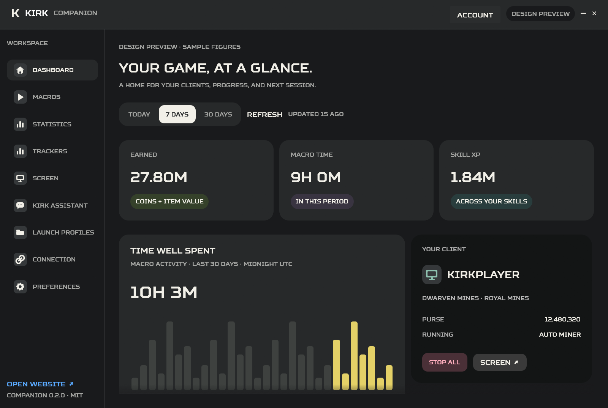

# Kirk Companion

A native **Rust** desktop dashboard for Kirk, fully open source under MIT. Built with egui/wgpu: no browser runtime or JavaScript in the app. Charcoal panels, warm white text, soft yellow accents, and the same Squares Bold font as Kirk Client.

**Preview:** Windows and the complete local integration flow are verified. The hosted backend still needs the companion/dashboard update before public pairing works. Local profiles work without pairing. [Windows preview releases](https://github.com/Benjamacs1/Kirk-companion/releases).



Copyright © 2026 Benja (Benjamacs1). [Copyright and licensing](COPYRIGHT.md). MIT requires retaining the copyright and permission notice.

## Inside the app

- Dashboard: player, area, purse, running macros, earnings, macro time, XP, activity chart, and quick launch.
- Macros: start/stop the nine Home macros, stop all, and use existing in-game warps.
- Statistics: Today / 7 / 30 days, license filters, daily activity, earnings by macro, and skill XP.
- Trackers: saved powder, profit, counters, and tracked items.
- Screen: on-demand game screenshots. Kirk assistant: shared game conversation and recent game chat.
- Launch profiles, computer pairing, native file pickers, tray, and optional start on login.

Historical figures cover the selected licenses. Live controls use the selected game client. Screenshots are on demand; continuous streaming, voice input, staff administration, license setup, and mod downloads remain on the website.

## Set up

1. Install on your gaming PC. Add a profile and **Test launch**. Kirk and its required Minecraft/Fabric version must already be installed in that instance.
2. On the website choose **Pair a computer**. Enter that code and PC name in the app's **Connection** page. Pairing lets this app read your dashboard and control your linked games. Remove the PC on either side to revoke it.
3. The dashboard refreshes automatically. Choose a game client when running multiple accounts. The website can start saved profiles while this PC is awake, signed in, and the companion is running.

Closing the window keeps it in the tray when available. **Quit** disconnects it. `kirk://open` opens the installed app; URL arguments never become commands. A successful launch means the request was dispatched, not that Minecraft finished loading or authenticated.

| Launch method | Behavior |
| --- | --- |
| Prism / MultiMC | Selected executable with separate `--launch <instance>` and optional `--dir <data folder>` arguments. Common instance folders are detected; portable installs are supported. |
| Instance shortcut | Opens a local exact-instance shortcut created by your launcher. Test it first. |
| Open launcher only | Opens the selected launcher. Choose your instance and press Play locally. |

All launchers can be opened locally. Exact-instance launching depends on the launcher's CLI or shortcuts; other launchers are clearly open-only. Minecraft login, Java, assets, and mods stay with the launcher. A 30-second guard prevents rapid duplicate launches.

## Build

Requires Rust 1.92+ and native C/C++ tools (Windows: Visual Studio Build Tools, Desktop C++ workload). No Kirk source, license, proprietary SDK, or Minecraft credentials are required.

```sh
cargo run --locked
cargo test --locked
cargo clippy --all-targets --locked -- -D warnings
cargo build --release --locked
```

Windows executable: `target/release/kirk-companion.exe`. Safe UI preview:

```sh
cargo run --locked -- --preview
cargo run --locked -- --preview --page macros
cargo run --locked -- --preview --narrow --screenshot artifacts/narrow.png
```

Preview pages: dashboard, macros, statistics, trackers, screen, assistant, profiles, editor, connection, preferences. Sample data is labelled. Preview mode never pairs or launches games.

For a Windows installer, install NSIS, put `makensis.exe` on PATH or set `NSIS_PATH`, and run `./tools/package.ps1`. Outputs in `dist/`: unsigned per-user installer, matching source ZIP, dependency notices, and SHA-256 checksums. Linux/macOS source builds run in CI; Windows is the locally verified GUI/installer target. Other native integrations still need hands-on platform testing.

## Architecture and privacy

`desktop.rs` / `dashboard_ui.rs`: native widgets. `service.rs`: pairing, background API work, launch socket. `dashboard.rs`: bounded HTTP responses. `launch.rs`: shell-free dispatch and discovery. `storage.rs`: atomic settings and OS credential store (Windows Credential Manager, macOS Keychain, Linux Secret Service). Without a secure store, pairing lasts until Quit.

Executable paths stay local. The app never reads launcher account stores or Minecraft access tokens. Account figures, screenshots, and conversations stay in memory and clear on unpair. Settings contain no credentials. [Protocol](docs/protocol.md), [security](SECURITY.md), [notices](THIRD_PARTY_NOTICES.md).

The app is MIT-licensed; this does not change the Kirk mod or hosted backend licenses. Neither private project is bundled. Compatible server behavior is documented for independent integration. The original Electron app remains in v0.1 Git history; layout experiments are preserved on the local `prototype/setup-styles` branch.
